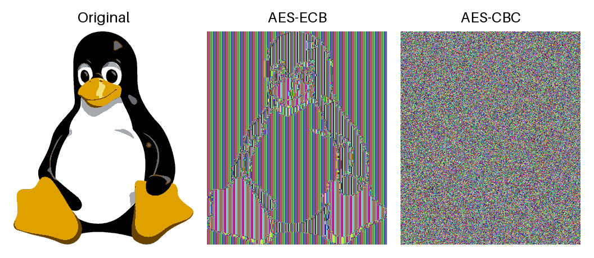
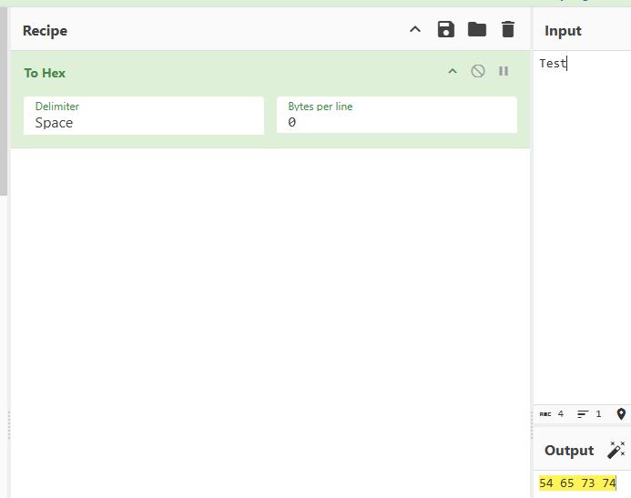

## Ne pas coder de la crypto soi-même

Vous n'avez sans doute pas le temps ni le niveau pour coder correctement de la crypto symétrique.

Le problème peut être l'algo qui est parfois naïf. Ou alors la mise en oeuvre qui plante.

:::warning
De nombreux exemples sur cette page mentionne l'encryption de mot de passe, mais on peut encrypter n'importe quel type de données. Pour un mot de passe, on utilise uniquement l'encryption (et non le hachage) lorsque l'on veut pouvoir lire le mot de passe décrypté. Dans une application de gestion de mot de passes, par exemple.
:::

## Implanter un algo classique via une librairie

Implanter le code C# pour faire la crypto symétrique est assez simple, on peut:
- chercher un peu dans la doc officielle : [classe Aes](https://learn.microsoft.com/fr-ca/dotnet/api/system.security.cryptography.aes)
- chercher sur Google et sauter sur le premier StackOverflow qui a de l'allure
- demander à ChatGPT « comment chiffrer avec AES en .NET »
- demander à Github Copilot direct dans mon VisualStudio

Il nous reste à choisir une clé de chiffrement pour la plupart des algorithmes:
- il faut que la clé soit difficile à deviner (un pirate pourrait essayer des clés comme il essaie des mots de passe)
- il faut s'assurer qu'on stocke la clé dans un endroit peu accessible

## Les modes de chiffrement (CipherMode)

:::info Qu'est-ce qu'AES exactement?
AES est un **chiffrement par bloc**: une fonction qui fait une seule chose.

```
AES(clé, bloc de 16 octets)  →  bloc de 16 octets chiffré
```

On peut le voir comme un **code de César géant**:

| | César | AES |
|---|---|---|
| Une « lettre » | 1 caractère | 1 bloc de 16 octets |
| Nombre de « lettres » possibles | 26 (ou 65, ou 95) | 2¹²⁸ ≈ 3,4 × 10³⁸ |
| La clé choisit... | un décalage parmi 26 | une table de substitution parmi 2²⁵⁶ (AES-256) |
| Analyse de fréquence | facile | impossible: on ne voit jamais deux fois le même bloc par hasard |
| Force brute | 26 essais | 2²⁵⁶ essais: plus que le nombre d'atomes dans l'univers |

À l'intérieur, AES répète plusieurs tours de substitutions et de transpositions (les deux familles vues au cours [3.3](/cours/r3.3)). Changer un seul bit du bloc d'entrée change environ la moitié des bits de sortie: c'est l'**effet avalanche**. Aucune attaque connue ne fait mieux que la force brute: **personne ne casse AES lui-même**. Ce qu'on attaque en pratique, c'est la clé, le mode ou l'IV.

En .NET, la classe `Aes` regroupe la brique AES, un mode (CBC par défaut) et un remplissage (PKCS7 par défaut). C'est pourquoi on parle souvent d'une configuration complète comme **AES-256-CBC**: la brique, la taille de clé, puis le mode.
:::

AES ne sait chiffrer qu'**un bloc de 16 octets** à la fois. Pour chiffrer un message plus long, il faut une règle pour découper le message en blocs et les enchaîner: c'est le **mode de chiffrement**. La sécurité dépend autant du mode que d'AES lui-même.

Une analogie: **AES est le moteur, le mode est la voiture**. Un excellent moteur dans une voiture sans freins (ECB) reste dangereux.

| Mode | Comment ça marche | IV / nonce | Ce qu'il protège | Verdict |
|---|---|---|---|---|
| **ECB** | Chaque bloc est chiffré seul, indépendamment des autres | Aucun | Rien de bien | ❌ À ne jamais utiliser |
| **CBC** | Chaque bloc est mélangé (XOR) avec le bloc chiffré précédent avant d'être chiffré; le premier est mélangé avec l'IV | IV aléatoire | Confidentialité | ✅ Correct, classique |
| **CTR** | AES chiffre un compteur, et le résultat sert de masque mélangé au message | Nonce unique | Confidentialité | ✅ Correct, rapide |
| **GCM** | Comme CTR, plus une **étiquette** (*tag*) qui détecte toute modification | Nonce unique | Confidentialité **et intégrité** | ✅✅ Le choix recommandé |

### Pourquoi ECB est dangereux

En ECB, le même bloc clair donne **toujours** le même bloc chiffré. C'est la même **localité** que le code de César, mais par blocs de 16 octets: deux utilisateurs qui ont le même mot de passe ont le même chiffré, et les motifs du message restent visibles.

L'exemple classique est le « pingouin ECB »: voici la même image chiffrée avec AES, en ECB puis en CBC, avec la même clé.



*Tux par Larry Ewing (lewing@isc.tamu.edu), créé avec The GIMP.*

Avec ECB, les grandes zones d'une même couleur donnent des blocs identiques, donc la silhouette du pingouin reste visible. Avec CBC, chaque bloc dépend des précédents et de l'IV: on ne voit que du bruit.

### Rappel: la localité

On a vu au cours [3.3](/cours/r3.3) qu'un chiffrement est **local** quand chaque morceau du message est chiffré seul, toujours de la même façon. On le reconnaît à deux symptômes:
- **même morceau clair → même morceau chiffré**, peu importe où il se trouve dans le message et peu importe le message
- **si on change un seul morceau du clair, un seul morceau du chiffré change**: le reste est identique

C'est dangereux parce que l'attaquant apprend des choses **sans avoir la clé**:
- il voit les répétitions: deux utilisateurs avec le même mot de passe ont le même chiffré
- il peut faire une analyse de fréquence sur les morceaux
- avec une attaque à texte clair choisi, il peut construire la table de traduction morceau par morceau

La seule différence entre les algorithmes, c'est la **taille du morceau**:

| Chiffrement | Taille du morceau | Local? |
|---|---|---|
| César, substitution | 1 caractère | ✅ Oui |
| AES-ECB | 1 bloc de 16 octets | ✅ Oui |
| AES-CBC, CTR, GCM avec un IV/nonce aléatoire | aucun: chaque bloc dépend de l'IV et des blocs précédents (ou d'un compteur) | ❌ Non: le même message chiffré deux fois donne deux résultats différents |

### En .NET

- `Aes.Create()` utilise **CBC** par défaut, avec le remplissage (*padding*) PKCS7 et un IV aléatoire
- l'énumération `CipherMode` propose aussi `ECB`: **méfiez-vous** des exemples trouvés en ligne ou générés par une IA qui utilisent `CipherMode.ECB` « pour simplifier », sans IV
- GCM ne passe pas par `CipherMode`, mais par une classe séparée: [`AesGcm`](https://learn.microsoft.com/fr-ca/dotnet/api/system.security.cryptography.aesgcm)
- ECB et CBC ont besoin de remplissage pour compléter le dernier bloc à 16 octets; CTR et GCM n'en ont pas besoin

## Le vecteur d'initialisation (IV)

La clé n'est pas le seul paramètre important. En mode CBC, l'IV doit être **aléatoire et différent pour chaque message**:
- si l'IV est toujours le même, deux textes identiques donnent le même texte chiffré: un attaquant voit qui a le même texte chiffré, donc également le même texte original sans rien déchiffrer
- l'IV n'est **pas secret**: on le stocke en clair avec le message, souvent au début (c'est ce que fait JeanLouisEtFils)
- en .NET, `Aes.Create()` génère déjà un IV aléatoire; l'erreur classique est de le remplacer par une valeur codée en dur

:::warning Chiffrer ne protège pas contre la modification
AES-CBC protège la **confidentialité**: on ne peut pas lire les données. Il ne garantit pas leur **intégrité**: rien n'empêche quelqu'un qui a la clé de modifier les données et de les rechiffrer. Pour détecter une modification, on utilise un mode authentifié comme **AES-GCM**. On le verra en pratique à l'atelier Paperclips (3.5).
:::

## Décompiler le .exe et trouver la clé

> Les solutions de cybersec, Jean-Louis et fils propose une solution de cybersécurité
> ultra sophistiquée de cybersécurité qui se présente en 2 applications ultra sécures
> 
> 1. Notre application utilisateur permet de chiffrer avec une clé de 256 bits (ça fait beaucoup) vos mots de passe afin de les stocker de façon sécuritaire. Même si un pirate accède à votre ordi il ne pourra pas décoder les mots de passe stockés. Nous utilisons un algo à la pointe du progrès AES (Advanced Encryption Standard), le standard mondial!
> 
> 2. Notre application gardée dans un lieu hyper sécuritaire nous permet si vous oubliez un mot de passe de le retrouver en nous contactant par courriel.


## Décrypter les données

C'est la même clé pour chiffrer et déchiffrer. Donc si on connaît la clé qui permet de chiffrer, on a tout ce qu'il faut pour déchiffrer.

On peut alors essayer de programmer un outil servant à décrypter les données avec le même algorithme, la même clé et les mêmes paramètres.
- programmer une application qui Decrypt avec AES et la clé qu'on a trouvée
- passer à travers le fichier ligne par ligne et décrypter les mots de passe

:::tip
Au lieu de programmer un décrypteur vous-mêmes, vous pouvez utiliser un outil déjà fait. Il suffit de ressortir tous les paramètres. Dans le cas de AES, on a:
- La clé symétrique (256 bits = 32 caractères ou 64 hex)
- Le vecteur d'initialisation (IV) (128 bits = 16 bytes)
- Le mode de chiffrement (CBC, CTR, ECB...)
- La méthode de remplissage (padding)

Voici un site qui permet de paramétrer l'algorithme: https://www.toolhelper.cn/en/SymmetricEncryption/AES
:::


## Quelles solutions pour cacher la clé

1. Principe #1, la clé ne doit pas être accessible aux utilisateurs. Il faut donc que la partie de la plateforme
qui chiffre se trouve dans les infrastructures de l'entreprise, pas chez les utilisateurs
2. Principe #2, moins il y a de gens qui ont la clé, moins il y a de chances de fuites.
3. On peut donc imaginer que seul le responsable du système en prod a accès à la clé de prod. Les dév peuvent 
avoir accès à une clé différente sur leur environnement de développement.

Concrètement, où met-on la clé?
- **Jamais dans le code source**: tout ce qui est dans le code se retrouve dans le .exe et dans l'historique Git
- **Dans la configuration du serveur**: une variable d'environnement ou un fichier de configuration qui n'est pas dans le repo
- **Dans un coffre de secrets** (*secrets manager*): par exemple Azure Key Vault, AWS Secrets Manager ou HashiCorp Vault. L'application demande la clé au démarrage, et les accès sont journalisés
- **Sur un poste Windows**: [DPAPI](https://learn.microsoft.com/fr-ca/dotnet/standard/security/how-to-use-data-protection) (`ProtectedData`) chiffre des données avec une clé liée au compte de l'utilisateur. Ça protège contre un autre utilisateur ou un vol de disque, mais pas contre l'utilisateur lui-même (principe #1)

## CyberChef

On va utiliser [CyberChef](https://gchq.github.io/CyberChef/) dans plusieurs CTFs, voici les différentes choses que vous devez savoir pour résoudre les problèmes.

Pour utiliser l'outil, il faut déplacer une opération de la colonne de gauche vers la colonne de recette (Recipe) juste à droite.

<details>
<summary>To et From Base64 et Hex</summary>
 
On va commencer par mettre To Base64. On va ensuite écrite un texte comme "Test" dans la partie Input en haut à droite et voir le résultat en bas à gauche.

||
|-|

:::tip
**Base64** est très utilisé pour transférer des données, c'est donc très pratique de pouvoir encoder ou décoder du Base64
:::

On va maintenant déplacer **From Base64** dans la colonne **Recipe** et voir que notre résultat est maintenant "Test". Pas surprenant, (ni même très utile...) mais on peut maintenant voir qu'on peut faire une séquence d'actions dans notre recette et que l'on peut encoder et ensuite décoder notre Base64.

||
|-|

:::tip
Dans les CTFs, l'input va déjà être en **Base64**
:::

On va devoir transformer du data en format **Hex** pour l'utiliser comme input quand on veut décrypter avec AES

||
|-|


</details>

<details>
<summary>Encryption AES</summary>
 
**Encryption AES**

Vous n'aurez pas à faire d'encryption dans les CTFs, mais voici comment et on va pouvoir utiliser le résultat comme entrée pour valider la décryption

||
|-|

:::tip
Choisissez l'option **Include IV in output: Prepend** pour que le résultat contiennent l'IV au début de la string. Ce qui est le cas dans notre application.
:::

:::warning
Le IV devrait être généré de façon aléatoire et la clé devrait être secrète et difficile à trouver!
:::

**Décryption AES**

Voici donc comment on peut décrypter:

||
|-|

:::tip
Le plus important c'est de noter l'option **IV from Input: From Start** en base à droite!

On indique de cette façon que l'IV fait partie de l'input et qu'il est au début de la string. Si vous regardez le bloque précédent, vous allez voir 
:::

</details>

<details>
<summary>Fork</summary>

Si vous voulez traiter plusieurs entrées à la fois, vous pouvez utiliser l'action **Fork**.

Voici un exemple qui utilise un simple **ToUpperCase** comme action après le **Fork**.

Il faut comprendre ici que le **split delimiter (\n)** signigie qu'il y a un saut de ligne entre chaque entrée.

Il faut également comprendre que le **merge** va se faire à la **fin** et **recombiner les résultats** avec le séparateur qui est spécifié.

||
|-|

On peut voir ici que même si on fait plusieurs opérations (le reverse en plus ici), le merge se fait une fois que toutes les étapes sont terminées. Pas seulement celle juste après le bloc Fork.


</details>

---

# Exercices et CTF

## Exercice: Décompiler JeanLouisEtFils

Nous avons acheté la super appli et nous avons chiffré quelques mots de passe pour s'en souvenir.

L'appli se trouve dans le dossier **stock/sym** JeanLouisEtFils du repo. Vous pouvez télécharger l'exécutable [JeanLouisEtFils.exe](https://github.com/departement-info-cem/3s4-cybersec/releases/latest/download/JeanLouisEtFils.exe).

- Essayez avec la commande **strings** pour trouver une chaîne dans un exécutable
- Essayez dotPeek pour décompiler l'appli
- La clé doit se trouver dans le code quelque part, explorez l'application pour trouver où se trouve la clé
de chiffrement. La bonne nouvelle c'est que comme AES est un algo symétrique, c'est aussi la clé
de déchiffrement

Pour valider tu peux utiliser l'application [corpoDecryptor.exe](https://github.com/departement-info-cem/3s4-cybersec/releases/latest/download/corpoDecryptor.exe) (code dans le dossier **stock/sym**).

---

## _Capture-the-flag_

Les défis suivants se valident sur la [plateforme CTF](https://ctf.info.cegepmontpetit.ca/challenges): chaque flag est de la forme `CEM{...}`.

<details>
<summary>🚩 La clé dans le .exe (1 point)</summary>

**Objectif** : extraire la clé de chiffrement et les paramètres de l'algorithme depuis un exécutable.

1. Télécharger [JeanLouisEtFils.exe](https://github.com/departement-info-cem/3s4-cybersec/releases/latest/download/JeanLouisEtFils.exe)
2. Le décompiler avec dotPeek ou ILSpy
3. Trouver l'algorithme utilisé pour chiffrer les mots de passe, son mode et sa clé

Attention : le projet contient deux classes de chiffrement. Vérifiez laquelle est **vraiment utilisée** par le programme.

Le flag est l'algorithme, le mode et la clé (en texte, comme dans le code), séparés par des tirets.

Format du flag : `CEM{algorithme-mode-clé}`

Collecte tes points CTF : https://ctf.info.cegepmontpetit.ca/challenges#La%20cl%C3%A9%20dans%20le%20.exe-102

</details>

<details>
<summary>🚩 Déchiffrer JeanLouisEtFils (5 points)</summary>

**Objectif** : utiliser la clé trouvée dans un exécutable pour déchiffrer des données réelles.

1. Lancer [JeanLouisEtFils.exe](https://github.com/departement-info-cem/3s4-cybersec/releases/latest/download/JeanLouisEtFils.exe), créer quelques mots de passe et localiser le fichier `encrypted-passwords.txt` qu'il écrit dans votre profil utilisateur
2. Déchiffrer vos propres mots de passe pour valider la méthode
3. Déchiffrer ensuite le fichier [encrypted-flag.txt](https://github.com/departement-info-cem/3s4-cybersec/raw/refs/heads/main/stock/encrypted-flag.txt), récupéré sur le poste d'un employé : un des mots de passe est le flag

Les paramètres trouvés dans le défi « La clé dans le .exe » sont nécessaires. Chaque ligne du fichier est au format `<IV + texte chiffré en Base64> @ <site>` : seule la partie avant le `@` est chiffrée.

- Convertir la partie Base64 en hexadécimal ([CyberChef](https://gchq.github.io/CyberChef/), recettes *From Base64* puis *To Hex*)
- Les 32 premiers caractères hexadécimaux (16 octets) sont l'IV, le reste est la donnée chiffrée
- Déchiffrer en AES-CBC avec la clé trouvée (recette *AES Decrypt* de CyberChef, ou https://www.toolhelper.cn/en/SymmetricEncryption/AES)

Format du flag : `CEM{...}`

Collecte tes points CTF : https://ctf.info.cegepmontpetit.ca/challenges#D%C3%A9chiffrer%20JeanLouisEtFils-101

</details>

<details>
<summary>🚩 Sans decryptor (3 points)</summary>

**Objectif** : déchiffrer **tout** le fichier de mots de passe — pas une seule ligne — sans l'outil corpoDecryptor du fournisseur.

Récupérer le fichier [encrypted-passwords.txt](https://github.com/departement-info-cem/3s4-cybersec/raw/refs/heads/main/stock/encrypted-passwords.txt), produit par JeanLouisEtFils. Chaque ligne contient le mot de passe d'un site, et **chaque mot de passe est un seul mot**. Déchiffrés dans l'ordre du fichier, ces mots forment une phrase : c'est le flag.

Les paramètres trouvés dans le défi « La clé dans le .exe » sont nécessaires. Chaque ligne du fichier est au format `<IV + texte chiffré en Base64> @ <site>` : seule la partie avant le `@` est chiffrée.

- Convertir la partie Base64 en hexadécimal ([CyberChef](https://gchq.github.io/CyberChef/), recettes *From Base64* puis *To Hex*)
- Les 32 premiers caractères hexadécimaux (16 octets) sont l'IV, le reste est la donnée chiffrée
- Déchiffrer en AES-CBC avec la clé trouvée (recette *AES Decrypt* de CyberChef, ou https://www.toolhelper.cn/en/SymmetricEncryption/AES)

Comme l'IV change à chaque ligne, il faut refaire l'opération pour **chacune** d'elles. Astuce : au lieu de tout faire à la main, tu peux automatiser le déchiffrement de toutes les lignes (un court script, ou l'opération *Fork* de CyberChef).

Le flag est la phrase obtenue, en minuscules avec ses espaces, dans l'ordre du fichier.

Format du flag : `CEM{...}`

Collecte tes points CTF : https://ctf.info.cegepmontpetit.ca/challenges#Sans%20decryptor-104

</details>

---

## Temps pour le TP

Continuez à travailler sur votre TP3.
